# Discussion 考点

老师说这些讨论页比较可能考。这里把已经发来的 Discussion / Class discussion 从各章里拎出来，按课上的主题排。原图在 `待补充/课堂照片/`。

下载 PDF 里的计算题仍然要会。这一份只收讨论页，外加 Week 2 笔记上和讨论贴在一起的那道单神经元手算。

两套损失不要混：

| | 四个点的线性回归（第 2 章末、第 3 章案例 1） | Week 2 讨论的单神经元 |
| --- | --- | --- |
| 损失 | `L = (ŷ - y)^2` | `L = (1/2)(t - y)^2` |
| 对输出的导数 | 带系数 2 | `1/2` 和链式法则抵消，`∂L/∂y = y - t` |
| 学习率 | 0.01 | 0.1 |
| 这页的数 | `x = 1,2,3,4`，从 `w = 0` 起步 | `x = 2`，`w = 3`，`b = 0`，目标 `t = 4` |

---

## 1. 用学生成绩说明一个神经元（Week 2）

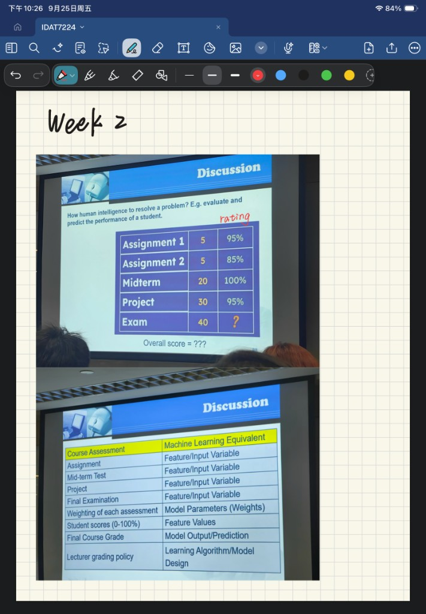


问：人怎样评估并预测一个学生的表现？总分等于多少？

投影上的权重和 rating：

| 项目 | 权重 | rating |
| --- | --- | --- |
| Assignment 1 | 5 | 95% |
| Assignment 2 | 5 | 85% |
| Midterm | 20 | 100% |
| Project | 30 | 95% |
| Exam | 40 | ？ |

权重加起来是 100。考试分数没给，所以总分不能写成一个确定的数。

```text
已定部分 = 5×0.95 + 5×0.85 + 20×1 + 30×0.95
         = 4.75 + 4.25 + 20 + 28.5
         = 57.5
考试贡献 = 40 × 考试分数的百分数
总分 = 57.5 + 考试贡献
```

旁边那张对照表要能默写：

| 课程 | 机器学习 |
| --- | --- |
| Assignment、期中、项目、期末考试 | 输入特征 |
| 各项占比 | 权重 |
| 学生分数 0–100% | 特征的取值 |
| 最终等级 | 模型输出 |
| 教师的评分政策 | 学习算法 / 模型设计 |

下载 PDF 里还有另一道已经算完的例子：占比 20%、20%、30%、30%，分数 80、70、90、75，加分 3，最终 82.5，等级 A。那是讲义例题，不是这张讨论表。

## 2. 预测更难的结果时做什么（Week 2）

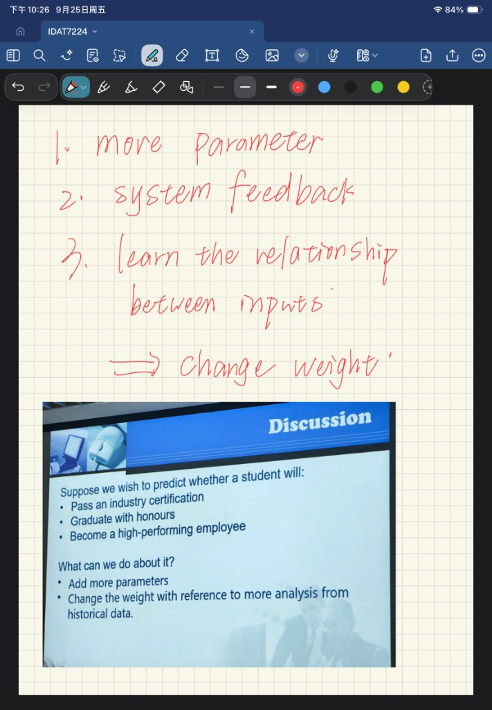


问：若要预测学生会不会通过行业认证、会不会荣誉毕业、会不会成为高绩效员工，可以做什么？

投影上的两条：

- 增加参数。
- 参照历史数据里的更多分析，去改权重。

笔记上多记了三点，考试若问「讨论里还说过什么」，可以写成：参数更多；系统有反馈；学习输入之间的关系，办法仍是改权重。

## 3. 层、反馈和参数量（Week 2，投影约第 32 页）

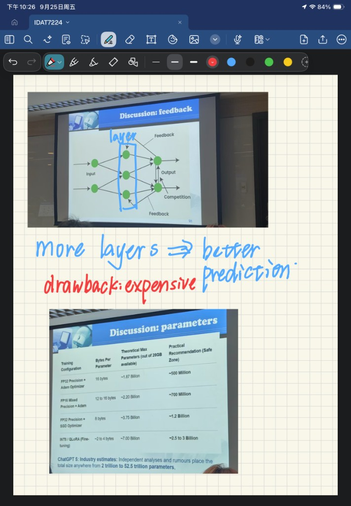


结构图是 Input，中间一层被圈出来的 layer，然后 Output。输出附近标了 Feedback 和 Competition。

笔记结论：层更多，预测可以更好；缺点是贵。

20GB 显存下，投影给的参数量表按原数记，不要自己用 20GB 再除一遍去改表：

| 训练配置 | 每个参数的字节 | 理论上限 | 实用建议 |
| --- | --- | --- | --- |
| FP32 + Adam | 16 | 约 18.7 亿 | 约 5 亿 |
| FP16 混合精度 + Adam | 12 到 16 | 约 22 亿 | 约 7 亿 |
| FP32 + SGD | 8 | 约 37.5 亿 | 约 12 亿 |
| INT8 / QLoRA 微调 | 约 2 到 4 | 约 70 亿 | 约 25 亿到 30 亿 |

同一页写：业界对 ChatGPT 5 的估计从 2 万亿到 52.5 万亿参数不等，投影自己标的是估计和传闻。

要记住的对比：同样 20GB，精度越低、优化器越省状态，能放下的参数越多；实用建议都比理论上限保守。Adam 比 SGD 更占字节。

## 4. 怎样学出一组好的权重（9 月 18 日，第 13 页）

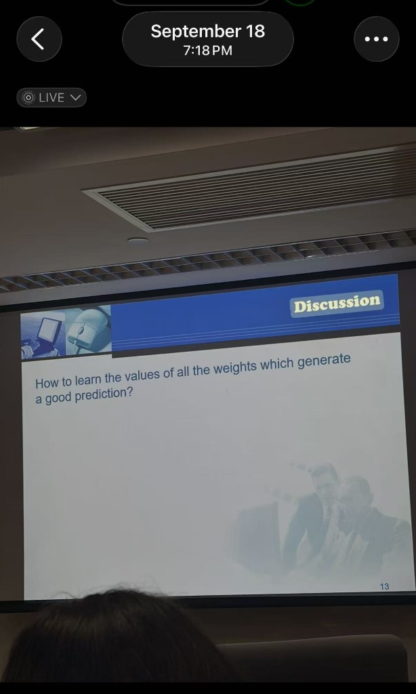


问：How to learn the values of all the weights which generate a good prediction?

投影没印答案。按后面的课件答：前向得到预测，用损失看错多少，梯度告诉每个权重该往哪边改、改多少，然后

```text
w_new = w_old - η ∂L/∂w
```

不要在这题里写 Adam、学习率调度或其他课件没用来回答这问的名字。

## 5. Week 2 的单神经元手算

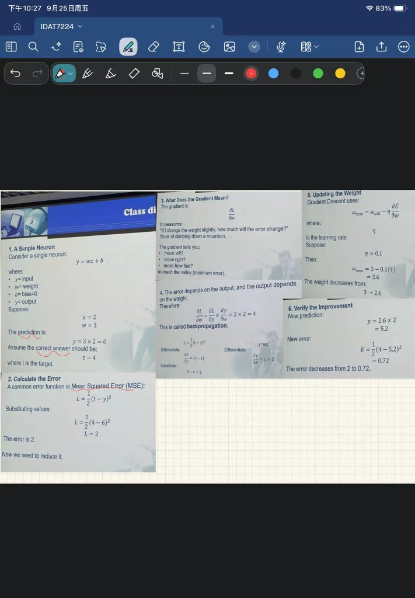


这页标题是 Class discussion 被截掉后的手算，六步都在投影上。用本节开头那一套带 `1/2` 的损失。

已知 `y = wx + b`，`b = 0`，`x = 2`，`w = 3`，目标 `t = 4`。

1. 预测：`y = 3 × 2 = 6`。
2. 损失用 `L = (1/2)(t - y)^2`。

```text
L = (1/2)(4 - 6)^2 = (1/2)×4 = 2
```

3. 梯度的意思：权重稍微变一点，误差会变多少。它同时说明往哪边走、走多快，目标是误差的谷底。
4. 误差依赖输出，输出依赖权重，所以用链式法则。投影把它叫做 backpropagation。

```text
∂L/∂y = y - t = 6 - 4 = 2
∂y/∂w = x = 2
∂L/∂w = 2 × 2 = 4
```

5. 更新。`η = 0.1`。

```text
w_new = 3 - 0.1×4 = 2.6
```

权重从 3 降到 2.6，因为预测 6 高于目标 4。

6. 检查。新预测 `y = 2.6 × 2 = 5.2`。

```text
L = (1/2)(4 - 5.2)^2 = (1/2)×1.44 = 0.72
```

误差从 2 降到 0.72。

## 6. 特征谁在主导（第 3 章讨论）

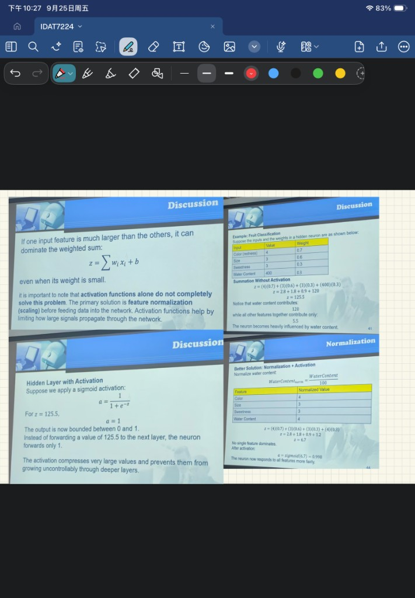


问的是：一个特征比别的大很多时会怎样。

```text
z = Σ w_i x_i + b
```

即使它的权重不大，也会主导加权和。激活函数只能限制大信号继续往深层传，不能从根上解决尺度不一致。主办法是送进网络之前做归一化。

水果例子，归一化前：

| 输入 | 值 | 权重 | 贡献 |
| --- | --- | --- | --- |
| 颜色 | 4 | 0.7 | 2.8 |
| 大小 | 3 | 0.6 | 1.8 |
| 甜度 | 3 | 0.3 | 0.9 |
| 水分 | 400 | 0.3 | 120 |

`z = 125.5`。水分贡献 120，其余三项一共 5.5。

隐藏层若用 Sigmoid，`z = 125.5` 时输出饱和为 1。下一层收到的是 1，不是 125.5。大数被压住了，但这个神经元实际上几乎只响应水分。

水分除以 100 之后变成 4，其余不变：

```text
z = 2.8 + 1.8 + 0.9 + 1.2 = 6.7
a = sigmoid(6.7) = 0.998
```

没有单一特征独大，神经元会同时看这些特征。

紧接着的课堂练习四问已经在 `02-习题.md` 第 21 题，这里不重复出题。

## 7. 近年为什么突破，数据在哪（9 月 4 日）


原因和课堂上的例子：

| 原因 | 例子 |
| --- | --- |
| 深度学习的进展 | Advances in Deep Learning |
| 大数据拿得到 | ImageNet |
| 算力 | Nvidia |
| 算法和优化 | Deepseek |
| 开源 | TensorFlow，PyTorch，Hugging Face Transformers |
| 规模变大 | 从百万级到万亿级变量 |
| 产业投入和需求 | Microsoft，Google，SpaceX |
| 成功会再催生成功 | ChatGPT |

库只要对上用途：

| 库 | 用途 |
| --- | --- |
| ImageNet | 整图分类 |
| MS COCO | 目标检测、图像描述 |
| Google Dataset Search | 检索各类公开数据集 |
| Kaggle | 社区数据，也用来比赛 |
| Hugging Face | NLP 语料和生成式数据 |
| UCI | 经典分类、回归的基准 |
| OpenML | 可重复的任务和流程性能 |
| AWS Open Data Registry | PB 级云数据，例如卫星 |
| Data.gov | 政府的人口、经济、公共记录 |

数据库：

| 类型 | 例子 | 适合 |
| --- | --- | --- |
| Vector | Pinecone，Milvus，Weaviate | 大模型、RAG、图像或音频相似度 |
| SQL | PostgreSQL，MySQL，SQL Server | 结构化业务数据、ACID、特征工程 |
| NoSQL / 内存 | MongoDB，Redis，Cassandra | 在线特征、JSON、低延迟 |
| 数据仓库 | BigQuery，Snowflake | PB 级训练、自动分析 |

数据仓库图：来源是业务系统、外部数据、平面文件；里面有元数据、汇总数据、原始数据；用来做分析、报表、挖掘。

## 8. AI agent 比人强在哪（9 月 4 日，第 36 页）


高度结构化、可重复的操作：全天工作、快速处理海量数据、持续监控库存销售物流、实时改价格和营销、立刻回复常规询问、降低运营成本。

例子：自动化仓库、高频交易、智能制造、在线广告。结论是某些操作任务上 AI 已经可以超过人。

和第 1 章正文的差别：正文强调 agent 是 reasoning、acting、evaluating 的循环；这页讨论的是它在哪些任务上已经比人好。

## 9. 电动车自动驾驶用什么（Week 2）

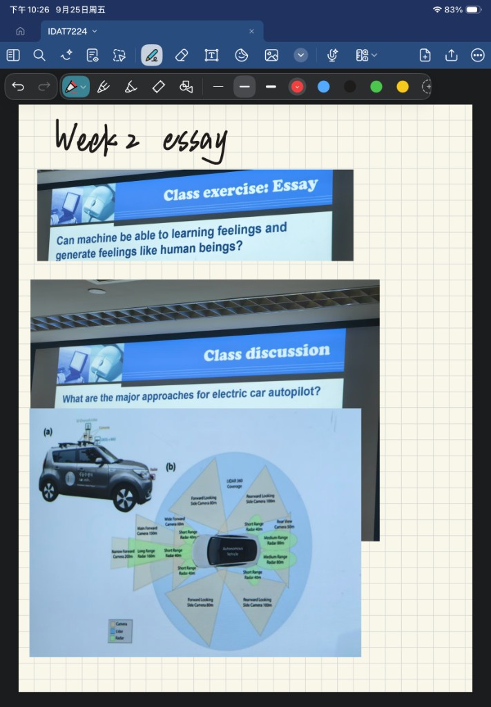


问：electric car autopilot 的主要途径是什么？

图上是三类传感器，不是三种网络：

- Camera：不同方向、不同距离，窄向前相机标到约 250 m，宽向前约 60 m。
- Lidar：360 度覆盖。
- Radar：短距、中距、长距都有，短距约 40 m，中距约 80 m。

考试若只问 major approaches，写出 Camera、Lidar、Radar。不必把每一个米数都背下来。

同一页笔记上还有一道已写过的短文，标题是 Class exercise 不是 Discussion：机器能否像人一样学习并产生 feelings。期中若再出现，按当时的短文立场答即可，不在这里展开。

## 10. 序列数据（第 4 章讨论）

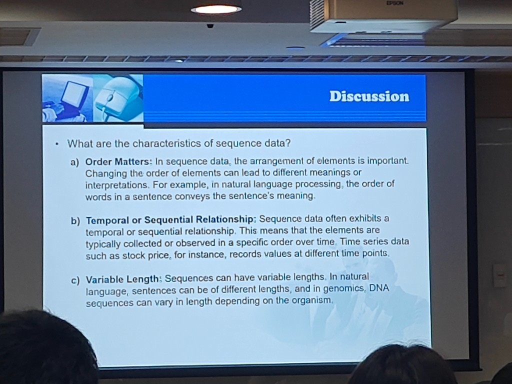

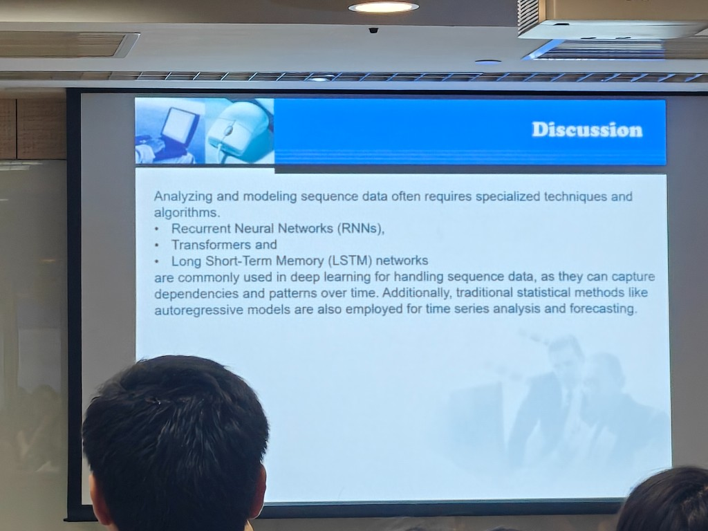


特点三条：

1. Order Matters。顺序一变，意思就变。例子是句子里的词序。
2. Temporal or Sequential Relationship。按时间、按固定顺序观测。例子是不同时刻的股价。
3. Variable Length。可长可短。句子长度不同；DNA 长度也随生物变化。

用什么建模：RNN、Transformer、LSTM 能抓住随时间的依赖。传统统计里还有自回归模型，用于时间序列分析和预测。

## 11. LSTM 怎么决定记不记（Class discussion）

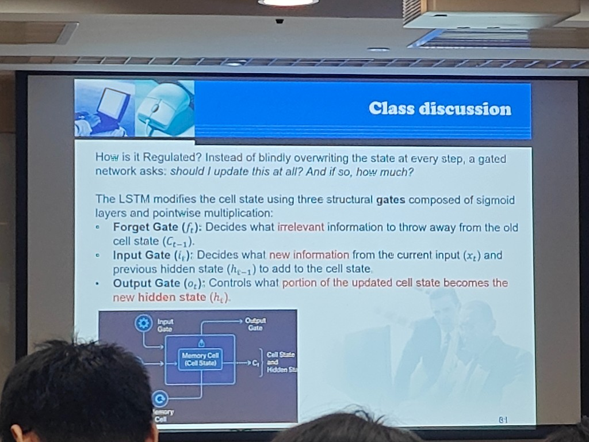


不要每一步都覆盖状态。先问：要不要更新？要的话更新多少？

三个门由 Sigmoid 和逐元素乘法组成：

- Forget gate：从旧细胞状态里丢掉 irrelevant 的信息。
- Input gate：把当前输入和上一隐藏状态里的 new information 写进去。
- Output gate：更新后的细胞状态里，哪一个 portion 变成新的隐藏状态。

公式和 Vancouver / Paris 的例子在复习资料第 4 章，这里只保留讨论页上标红的这三个词。

## 12. 怎样把顺序计算改成并行（投影页角 111、112）

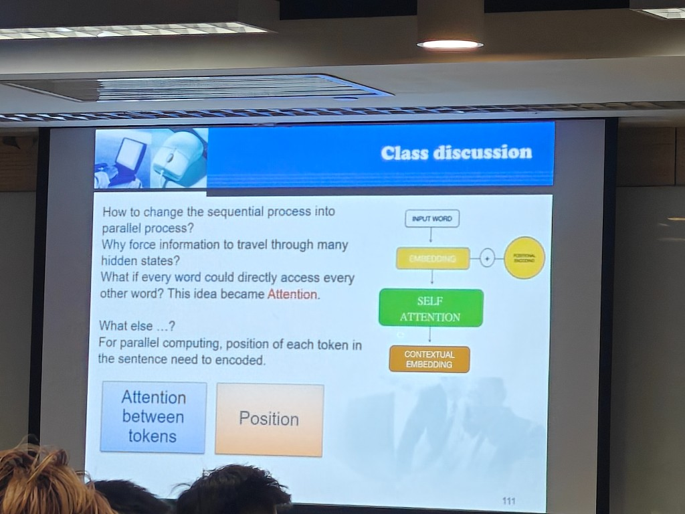

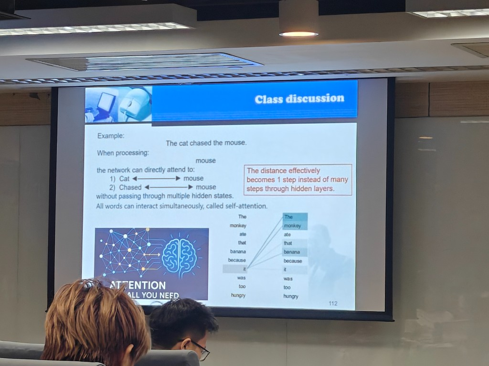


两件事：

- Attention between tokens：每个词直接看其他词。这个想法就是 Attention。
- Position：并行之后不再从左到右走，每个 token 的位置必须另外编码。

数据流：

```text
INPUT WORD → EMBEDDING + POSITIONAL ENCODING → SELF ATTENTION → CONTEXTUAL EMBEDDING
```

例子：The cat chased the mouse。处理 mouse 时可以直接看 cat 和 chased，距离变成 1 步，这叫 self-attention。同一页还有 The monkey ate that banana because it was too hungry，`it` 直接连到句中其他词，没有另给百分比。

`it was tired` 那道带 60%、20% 的六步仍在复习资料里，讨论页没有重算那组数。

---

## 自测

做完再看后面的答案。

**D1.** Week 2 那张成绩表，不假设考试分数，已定部分是多少？考试那一项在式子里怎么写？

**D2.** 预测认证、荣誉毕业、高绩效员工时，投影给了哪两条办法？

**D3.** 同样大约 20GB，FP32+Adam 和 FP32+SGD 的实用建议各大约是多少参数？笔记里「层更多」的好处和缺点各是什么？

**D4.** 用 Week 2 的数做完六步：预测、损失、梯度、新权重、新预测、新损失。说明这题的损失为什么梯度里没有额外的系数 2。

**D5.** 水分是 400 时，`z` 是多少，水分贡献占了多少？除以 100 之后 `z` 和 Sigmoid 输出是多少？为什么不能只靠 Sigmoid 解决这个问题？

**D6.** ImageNet、Nvidia、Deepseek、ChatGPT 各对应哪一条突破原因？Vector 数据库课堂上举了哪类产品，用来做什么？

**D7.** agent 讨论页和「聊天机器人只回一句」的差别，各用一句话。自动驾驶讨论页的三类传感器是什么？

**D8.** 序列数据三条特点，各一个例子。讨论页点名的三种深度学习结构和一种统计方法是什么？把顺序计算改成并行时，必须同时有的两样东西是什么？

## 答案

**D1.** 已定部分 57.5。总分 = `57.5 + 40 × 考试分数的百分数`。考试 rating 是问号，不能编一个总分。

**D2.** 增加参数；参照历史数据分析去改权重。

**D3.** FP32+Adam 实用约 5 亿；FP32+SGD 实用约 12 亿。层更多可以让预测更好，缺点是贵。

**D4.**

```text
y = 6
L = 2
∂L/∂w = 4
w = 2.6
新预测 = 5.2
新损失 = 0.72
```

损失写成 `(1/2)(t-y)^2` 时，对 `y` 求导，`1/2` 和平方带来的 2 抵消，只剩下 `y - t`。四个点那题没有这个 `1/2`，所以那里要保留系数 2。

**D5.** `z = 125.5`，其中水分 120，其余 5.5。除以 100 后 `z = 6.7`，Sigmoid 为 0.998。Sigmoid 把 125.5 压成 1，只是不让大数继续炸开，神经元仍然几乎只看水分。

**D6.** ImageNet 是大数据，Nvidia 是算力，Deepseek 是算法和优化，ChatGPT 是成功会再催生成功。Vector 的例子是 Pinecone、Milvus 或 Weaviate，用于大模型、RAG 和相似度搜索。

**D7.** 正文里的 agent 是持续的 reasoning、acting、evaluating；讨论页说的是它在仓库、交易、制造、广告这类结构化任务上可以比人好。自动驾驶的三类是 Camera、Lidar、Radar。

**D8.** 词序改变句意；股价按时刻记录；句子或 DNA 长度不固定。结构是 RNN、Transformer、LSTM；统计方法是自回归模型。并行还要有 token 之间的注意力，以及位置编码。
